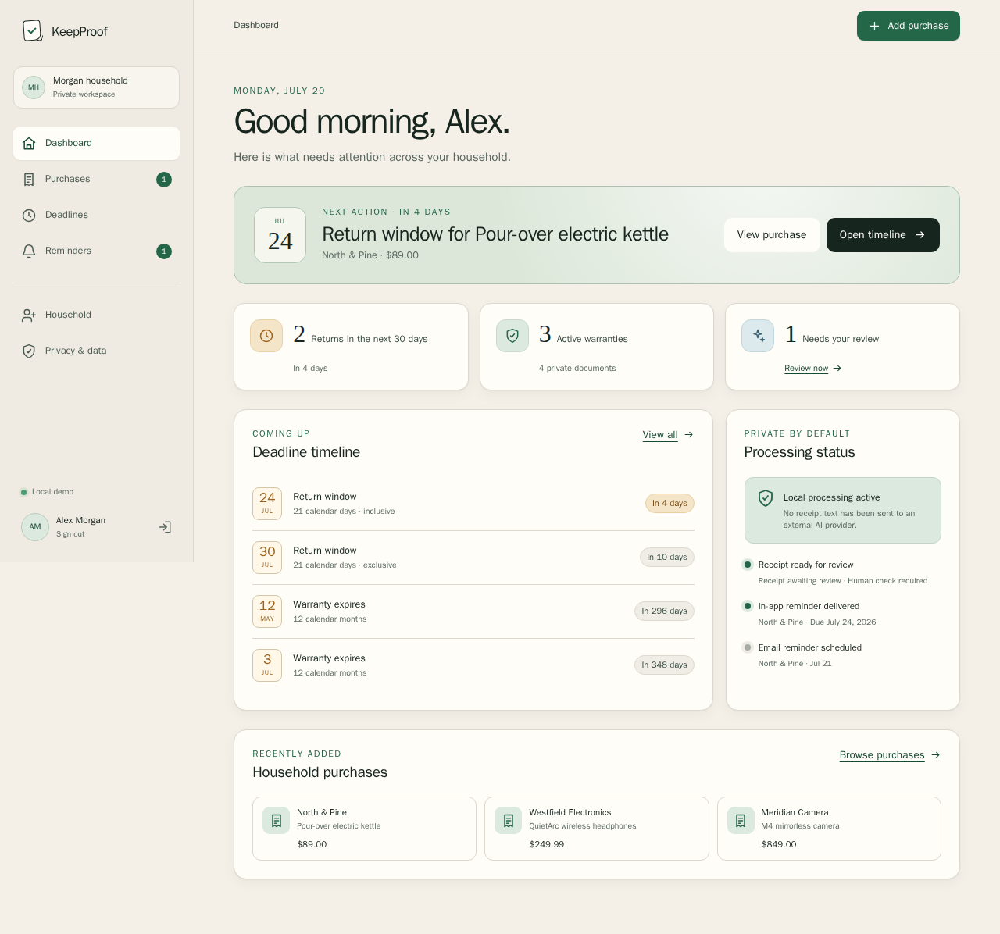
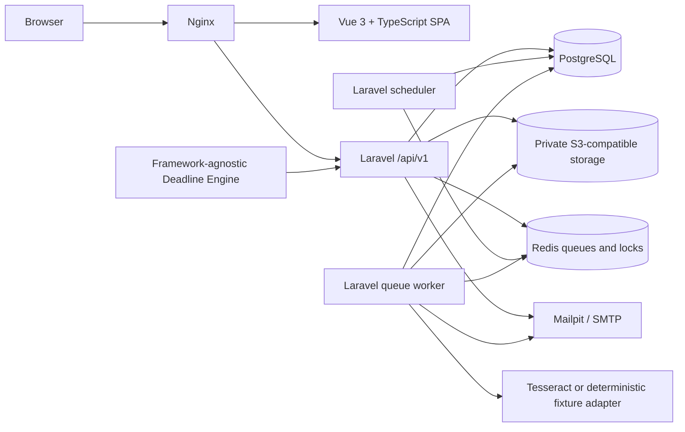
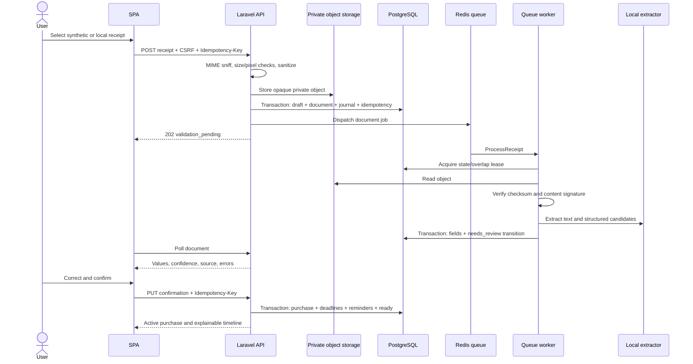
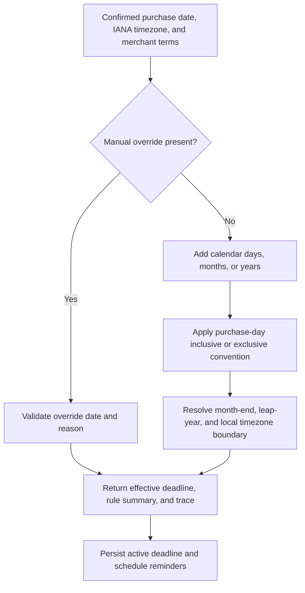

# KeepProof

**Never miss a return window or warranty deadline.**

KeepProof is a privacy-first receipt, return-window, and warranty tracker for people and households. Save proof of purchase, review locally extracted details, and turn the terms you confirm into explainable deadlines, reminders, calendar events, and portable claim packages.

This repository is a production-oriented portfolio project built as a Laravel modular monolith with a Vue and TypeScript SPA. It works locally without a paid API and treats external AI as an explicit, off-by-default boundary.



_Generated by the passing Playwright visual test from synthetic demo data. [See the mobile dashboard](docs/assets/screenshots/dashboard-mobile.png) or [the landing page](docs/assets/screenshots/landing.png)._

## The problem

Receipts live in inboxes, bags, downloads, and camera rolls. Return terms and warranty dates are easy to forget, and reconstructing proof only becomes urgent when something goes wrong. Existing solutions often make the document itself secondary, hide how dates were calculated, or require sending sensitive purchase data to an external processor.

## The solution

KeepProof keeps the evidence and the action date together:

1. Add a purchase manually or upload a JPG, PNG, or PDF receipt.
2. Store the sanitized original in private S3-compatible storage.
3. Process it asynchronously with a deterministic demo extractor or local Tesseract OCR.
4. Review every extracted field, its source, confidence, and validation errors.
5. Confirm or correct the values before any deadline becomes active.
6. Receive in-app and local email reminders, export an ICS event, or build a claim ZIP.
7. Export the account or delete its data and private objects.

KeepProof records merchant terms supplied by the user or document. It does not provide legal advice or determine rights under local law.

## User flows implemented

- Registration, stateful-cookie login/logout, email verification through Mailpit, password reset, recent-password confirmation, profile timezone, and account deletion.
- A personal household created atomically at registration, owner/member roles, minimal email invitations, ownership transfer, and tenant-scoped authorization.
- Manual purchases and receipt uploads with items, integer minor-unit money, return/warranty terms, manual overrides, filters, pagination, and indexed search.
- Controlled document states: `uploaded`, `validation_pending`, `processing`, `needs_review`, `ready`, `failed`, and `quarantined`.
- Field-level extraction review followed by one transaction that activates the purchase, explainable deadlines, and deduplicated reminders.
- Dashboard actions, deadline timeline, in-app notifications, email notifications, ICS, claim ZIP, account ZIP, and original-document deletion.
- A connected browser test proving the full receipt lifecycle and cross-household denial against real PostgreSQL, Redis, S3-compatible storage, queue, scheduler, mail, and HTTP services.

## Engineering highlights

- **A focused modular monolith.** Capability modules share one transactional database and deployment while keeping HTTP, application actions, domain rules, and infrastructure boundaries visible.
- **Independent deadline logic.** [`packages/deadline-engine`](packages/deadline-engine/README.md) has strict types, immutable value objects, no Laravel dependency, explainable rule traces, and 46,276 boundary assertions.
- **Database-authoritative async work.** Redis carries wake-ups; receipt state and a renewable dispatch lease remain in PostgreSQL so a minute scheduler can recover stranded work.
- **Explicit failure semantics.** Jobs are overlap-protected and bounded. Permanent failures quarantine; transient failures retry; an ambiguous SMTP interruption becomes `delivery_unknown` instead of risking a duplicate email.
- **Human confirmation as a trust boundary.** OCR and optional AI produce provisional candidates only. Confirming the review is the transaction boundary for purchase activation, deadline calculation, reminders, field provenance, and the state transition to `ready`.
- **Private file handling.** Content-derived MIME checks, image re-encoding, pixel and size limits, opaque object keys, checksum validation, active-PDF markers, short-lived signed URLs, and storage cleanup are covered by feature tests.
- **Contract-first SPA.** The `/api/v1` OpenAPI 3.1 document is linted and generates the TypeScript client types used by the Vue application. Errors use Problem Details with a correlation ID.
- **Operational proof.** Clean migrations, readiness checks, synthetic seeding, Docker health checks, queue reconciliation, backups, CI, SBOM artifacts, and a reproducible local load probe are included.

## Architecture



The Laravel application is split into Accounts, Households, Purchases, Documents, Notifications, Exports, and Shared infrastructure. Controllers validate and authorize; verb-named actions own transactional use cases; provider interfaces exist only at OCR, extraction, redaction, storage, mail, and queue boundaries. See [Architecture](docs/ARCHITECTURE.md) and the [ADRs](docs/adr/).

## Receipt processing sequence



If queue dispatch is unavailable after the upload transaction, the API returns the durable document with a delayed-processing message. The scheduled reconciliation command redispatches stale database leases; Redis is not the source of truth.

## Deadline calculation flow



The engine solves only purchase return and warranty dates. It is deliberately not a generic rules platform and does not contain a jurisdictional law database.

## Technology choices

Versions below are the tested, pinned release-candidate baseline, not a promise to follow every newest release automatically. Lockfiles and image tags are authoritative.

| Component         | Pinned version | Reason                                                                                                |
| ----------------- | -------------: | ----------------------------------------------------------------------------------------------------- |
| PHP               |          8.5.8 | Current supported branch, strict backend/package baseline                                             |
| Laravel           |        13.20.0 | API, policies, sessions, queues, scheduler, notifications, and storage without extra framework layers |
| PostgreSQL        |           18.4 | Transactional source of truth, constraints, indexes, and database sessions                            |
| Redis             |          8.2.7 | Replaceable queue wake-ups, cache, and non-authoritative overlap locks                                |
| Vue               |         3.5.40 | Accessible, component-based SPA with a small runtime                                                  |
| TypeScript / Vite |  6.0.2 / 8.1.5 | Strict contract use and reproducible production build                                                 |
| Node.js           |    24.18.0 LTS | Supported frontend and Playwright toolchain                                                           |
| SeaweedFS         |           4.39 | Lightweight local S3-compatible private storage; the application uses Flysystem's S3 boundary         |
| Tesseract         |          5.5.0 | Optional local OCR without a paid account                                                             |
| Nginx             |         1.30.4 | Same-origin routing, request limits, security headers, and production static assets                   |

The baseline was checked against the official [PHP support table](https://www.php.net/supported-versions.php), [Laravel 13 support policy](https://laravel.com/docs/13.x/releases), [Node release schedule](https://nodejs.org/en/about/previous-releases), [PostgreSQL 18.4 documentation](https://www.postgresql.org/docs/current/), [Redis 8.2 release notes](https://redis.io/docs/latest/operate/oss_and_stack/stack-with-enterprise/release-notes/redisce/redisos-8.2-release-notes/), and upstream release pages for [Vue 3.5.40](https://github.com/vuejs/core/releases/tag/v3.5.40) and [SeaweedFS 4.39](https://github.com/seaweedfs/seaweedfs/releases/tag/4.39). Symfony 8.1 and Yii3 were also reviewed for future package examples, but neither is a runtime dependency of the MVP.

## Run locally

Requirements: Docker Engine with Compose v2-compatible commands, Git, and approximately 4 GiB of free memory. GNU Make is optional on Windows.

```bash
git clone <your-fork-url> keepproof
cd keepproof
make setup
make demo
```

Windows PowerShell:

```powershell
./scripts/kp.ps1 setup
./scripts/kp.ps1 demo
```

Then open:

- Application: <http://localhost:8080>
- API documentation: <http://localhost:8080/docs/api>
- Raw OpenAPI document: <http://localhost:8080/docs/openapi.yaml>
- Mailpit: <http://localhost:8025>
- Liveness: <http://localhost:8080/health/live>
- Dependency readiness: <http://localhost:8080/health/ready>

If port 8080 is occupied, set `APP_PORT` in the root `.env`, for example `APP_PORT=18080`. `make reset` removes only the named KeepProof development containers and volumes; it is destructive to local demo data.

## Demo credentials

The following account exists only after `make demo` / `kp.ps1 demo` and is rejected by the seeder outside local or test environments:

```text
Email:    demo@keepproof.local
Password: KeepProof!2026
```

The landing-page **Try the local demo** path provides an immediate synthetic walkthrough. Signing in with the account above exercises the connected Laravel API and seeded S3 objects. Mailpit captures local verification, reset, invitation, and reminder email without sending mail externally.

## Commands and verification

| Command                    | Purpose                                                                                                                                           |
| -------------------------- | ------------------------------------------------------------------------------------------------------------------------------------------------- |
| `make setup`               | Build development images, install locked dependencies, generate the local app key, migrate PostgreSQL, and prepare private storage                |
| `make up` / `make down`    | Start the healthy stack / stop it without deleting named data volumes                                                                             |
| `make demo`                | Start the stack and refresh the fully synthetic demo dataset                                                                                      |
| `make test`                | Backend, Deadline Engine, and frontend unit tests                                                                                                 |
| `make quality`             | Composer validation/audit, Pint, PHPStan/Larastan, backend tests, OpenAPI lint, Prettier, ESLint, TypeScript, frontend tests/build, and npm audit |
| `make e2e`                 | Desktop and mobile Playwright suite, including the connected infrastructure path and accessibility smoke test                                     |
| `make load`                | Authenticated read and private-upload development regression probe                                                                                |
| `make production-build`    | Build production PHP-FPM and static Nginx images without publishing them                                                                          |
| `make seed` / `make reset` | Refresh synthetic data / remove KeepProof local containers and volumes                                                                            |

The latest local release-candidate audit is recorded in the [Testing Strategy](docs/TESTING.md), [Case Study](docs/CASE_STUDY.md#testing-strategy), and [Local Performance Baseline](docs/performance/LOCAL_BASELINE.md). [`.github/workflows`](.github/workflows/) is configured to repeat the same underlying gates in CI.

## Security and privacy

- Sanctum stateful cookies, CSRF verification, exact CORS origins, secure production cookie settings, session regeneration, email verification, password hashing, and layered throttles.
- Tenant-first route binding plus Laravel Policies. Foreign household and nested purchase identifiers return a non-disclosing 404 and are covered in PHP and connected Playwright tests.
- Receipt contents, OCR text, signed URLs, secrets, and credentials are excluded from structured logs. Correlation IDs remain safe to expose.
- External AI is disabled by default, requires per-document consent, redacts text, enforces size/token/cost/time limits, validates strict JSON Schema, stores provider/prompt metadata, and never activates a deadline.
- No advertising trackers, third-party analytics, real receipts, or real personal data are included.
- Export and deletion require recent password confirmation and write audit events. Original receipts can be removed separately after extraction.

Start with [Security Policy](SECURITY.md), [Threat Model](docs/security/THREAT_MODEL.md), and the evidence-linked [OWASP ASVS Level 1 baseline](docs/security/ASVS_LEVEL_1.md). These are practical controls, not a certification or an external penetration test.

## API

The public contract is [`apps/backend/openapi/openapi.yaml`](apps/backend/openapi/openapi.yaml). All application endpoints are versioned under `/api/v1`; local Swagger UI is available at `/docs/api`.

Authenticated SPA requests use same-origin cookies and CSRF, not bearer tokens stored in browser storage. Validation, authentication, authorization, throttling, and unexpected failures use `application/problem+json` with a request correlation ID. Generated frontend types live in [`apps/frontend/src/api/generated`](apps/frontend/src/api/generated/).

## Deliberate trade-offs

- A modular monolith keeps transactions, policies, migrations, and local operation coherent. OCR and extraction have interfaces; business modules do not gain repositories or service abstractions without a real boundary.
- PostgreSQL is authoritative, but S3 and the database cannot share a transaction. Upload writes the object first and compensates by deletion if the database transaction fails. Account deletion is synchronous and object-first to avoid claiming deletion while files remain.
- Queue processing is at-least-once. State locks, idempotency records, unique reminder keys, overlap middleware, and reconciliation make retries safe; exactly-once delivery is not claimed.
- Email can fail after the SMTP handoff becomes unknowable. KeepProof records `delivery_unknown` and asks for operational reconciliation rather than automatically sending a possible duplicate.
- The development stack favors one-command clarity. Published load figures are from that stack and are not production sizing evidence.

See the seven accepted decisions in [`docs/adr`](docs/adr/) and deeper rationale in [Maintainer Notes](docs/MAINTAINER_NOTES.md).

## Current limitations

- English is the only shipped UI catalog. Locale is an account/API field and English is the stable default, but translation extraction and a second catalog remain roadmap work.
- Local Tesseract and deterministic patterns target printed synthetic receipts; handwriting, damaged scans, arbitrary layouts, and legal interpretation are outside scope.
- PDF validation rejects known active/embedded-content markers, but there is no antivirus/CDR service or explicit PDF page-count limit. A real deployment should add malware scanning appropriate to its threat model.
- The optional provider-agnostic LLM adapter has contract and prompt-injection tests but is not exercised against a paid provider in CI.
- Account deletion is blocked while the user owns a household with other members; ownership must be transferred first. Cross-system deletion does not provide a distributed transaction.
- Production images and ingress were built and smoke-tested locally. Matching GitHub workflows are defined, but no remote CI run is claimed because this checkout has no configured GitHub origin; there is also no public deployment, monitored backup-restore drill, delivery provider, or external security assessment.
- The API documentation route is lazy-loaded, but its current minified JavaScript chunk is about 1.38 MB (395 KB gzip). It does not affect the main application bundle; trimming the documentation viewer remains a release follow-up.
- Symfony and Yii3 package examples are not merged into the MVP. They remain issue-ready stretch work so incomplete framework scaffolds do not dilute the core application.

## Roadmap

Issue-ready scopes and acceptance criteria live in [Stretch Issues](docs/roadmap/STRETCH_ISSUES.md):

1. Symfony 8.1 Deadline Engine integration example.
2. Yii3 Deadline Engine integration example.
3. Profiling-gated FastAPI OCR worker evaluation.
4. Expiring read-only claim-package share link.
5. Signed outbound webhooks.
6. A second locale and extracted message catalog.
7. Web Push reminders.

## Review this project

- [5–7 minute recruiter tour](docs/RECRUITER_TOUR.md)
- [Architecture](docs/ARCHITECTURE.md)
- [Case study](docs/CASE_STUDY.md)
- [Testing strategy and critical-risk matrix](docs/TESTING.md)
- [Implementation plan and acceptance gates](docs/IMPLEMENTATION_PLAN.md)
- [Maintainer interview notes](docs/MAINTAINER_NOTES.md)
- [Contributing](CONTRIBUTING.md) and [Changelog](CHANGELOG.md)

## License

KeepProof is available under the [MIT License](LICENSE). MIT was chosen to keep reuse, learning, and independent Deadline Engine adoption straightforward while preserving attribution and the standard warranty disclaimer.
