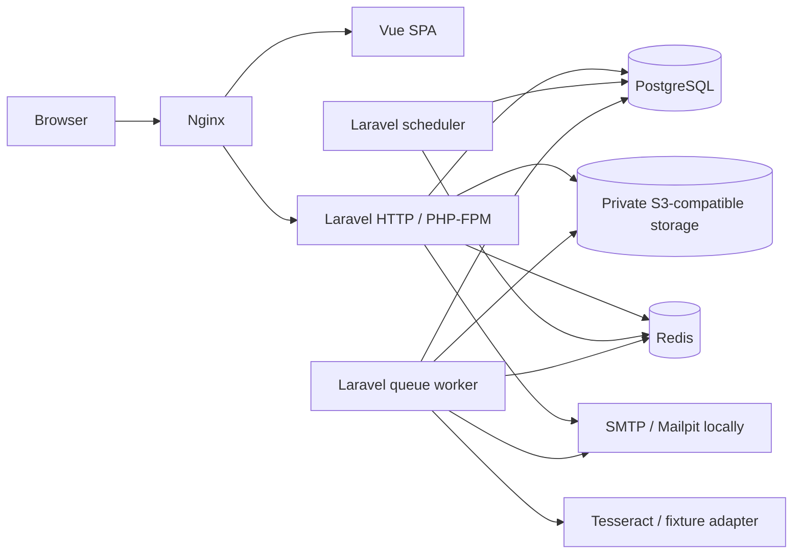
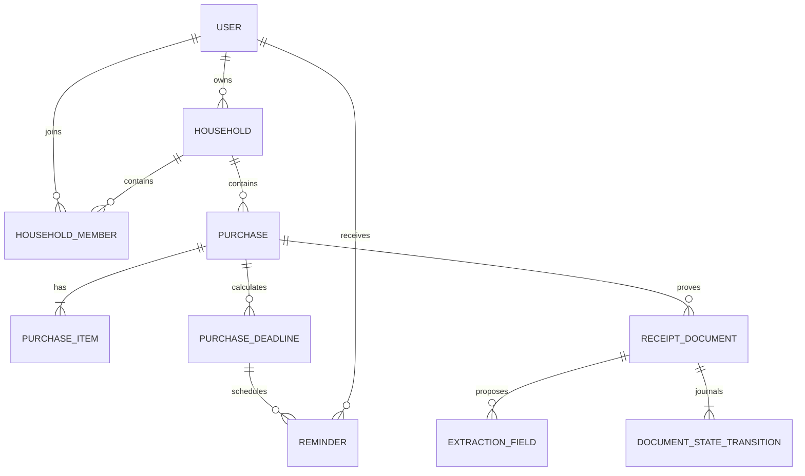
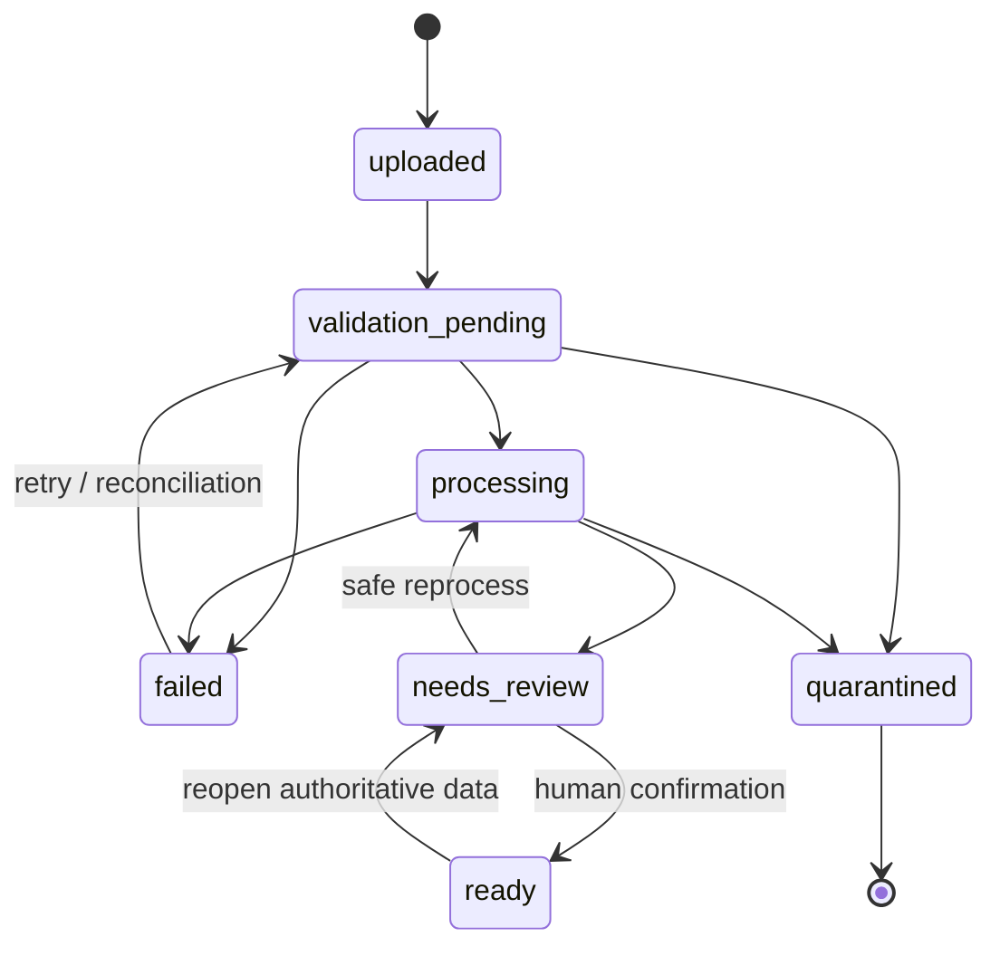

# KeepProof Architecture

Status: release-candidate architecture snapshot, 2026-07-20

KeepProof is a modular monolith: one Laravel codebase and transactional PostgreSQL database, one Vue SPA, and separate runtime processes for HTTP, queues, and scheduling. The structure makes capability boundaries explicit without turning in-process calls into a distributed system.

## Architectural goals

- Complete the private receipt-to-deadline path without an external paid service.
- Keep tenant authorization visible at routing, policy, and query boundaries.
- Keep purchase date rules independent from Laravel and infrastructure.
- Make asynchronous processing retryable, bounded, observable, and recoverable after Redis loss.
- Treat OCR and optional AI as untrusted proposal generators, never as the source of truth.
- Keep local operation predictable while preserving clear production storage, database, and worker boundaries.

## Runtime containers

Development serves Vue through Vite and Laravel through its local HTTP server. The production build replaces them with compiled static assets in Nginx and PHP-FPM. PostgreSQL, Redis, S3-compatible storage, SMTP, worker, and scheduler boundaries remain the same.

## Modules

| Module                  | Owns                                                                           | May depend on                                                       |
| ----------------------- | ------------------------------------------------------------------------------ | ------------------------------------------------------------------- |
| Accounts                | identity, authentication actions, profile, export, deletion                    | Households during registration/deletion; Shared audit               |
| Households              | household, memberships, invitations, ownership                                 | Accounts identity; Shared audit                                     |
| Purchases               | purchases, items, active deadlines, search                                     | Households, Notifications scheduling, Deadline Engine, Shared audit |
| Documents               | receipt objects, state journal, OCR/extraction candidates, review confirmation | Accounts, Households, Purchases, Shared audit/idempotency           |
| Notifications           | preferences, reminder schedule, in-app/email delivery state                    | Accounts, Purchases                                                 |
| Exports                 | ICS and claim archives                                                         | Authorized Purchases/Documents reads and storage                    |
| Shared                  | Problem Details, correlation IDs, audit, log redaction, idempotency            | Framework/infrastructure only                                       |
| Deadline Engine package | calendar arithmetic, conventions, overrides, explanations                      | PHP standard library only                                           |

Directories under [`apps/backend/app/Modules`](../apps/backend/app/Modules/) group these capabilities. The separation is organizational and dependency-oriented; modules deliberately share Eloquent transactions when one user action needs atomic state.

## Dependency direction

1. Nginx and HTTP routes are adapters.
2. Controllers use dedicated Form Requests, tenant-aware route bindings, Policies, and API Resources.
3. Verb-named actions such as `UploadReceipt`, `ConfirmExtraction`, and `SchedulePurchaseReminders` own use cases and transaction boundaries.
4. Eloquent models and database constraints are used directly inside the application. There is no generic repository layer.
5. `keepproof/deadline-engine` is injected as ordinary PHP code and has no reference to Laravel.
6. Interfaces exist where an implementation can cross a trust or infrastructure boundary: document text extraction, receipt data extraction, and text redaction. Flysystem, Laravel queues, mail, and HTTP clients already provide framework contracts elsewhere.

Controllers do not calculate dates, run OCR, construct storage keys, or make authorization decisions from request IDs alone. Domain code does not depend on Vue, Nginx, or HTTP response shapes.

## Request lifecycle

1. Nginx applies request-size and response-security headers and routes `/api`, `/sanctum`, and `/health` to Laravel.
2. `AssignCorrelationId` accepts a valid UUID or generates one, adds it to structured log context, and returns it in `X-Correlation-ID`.
3. Exact CORS origins and Sanctum's stateful-cookie middleware establish same-origin SPA sessions. Unsafe requests require the CSRF cookie/header pair.
4. Named and global throttles run before the controller.
5. `auth:sanctum` and `verified` protect application routes. A signed email verification link uses the `web` session middleware because top-level email navigation does not carry Sanctum's `Origin` signal.
6. Tenant-aware route binding loads a household through the authenticated user's memberships, then loads nested purchases/documents through that household. A mismatched identifier becomes 404 before controller code.
7. A Form Request validates and normalizes the boundary. The controller invokes a Policy and calls one action.
8. The action commits its database work, performs explicit external-boundary compensation where needed, and returns a model.
9. An API Resource serializes the response. Validation, authentication, authorization, not-found, throttling, and unexpected exceptions become Problem Details for `/api/*`.

## Data model and tenant boundary

Public records use ULIDs. Tenant-owned tables carry `household_id`, foreign keys, and compound indexes for their main access paths. Money is an integer `total_minor` / `unit_price_minor` plus a currency code. Calendar due dates retain their IANA timezone while scheduled instants are normalized to UTC.

Isolation is defense in depth:

- authenticated-user household route binding;
- household-scoped nested binding for purchases and documents;
- Policies checking membership or owner role;
- `household_id` on purchases, documents, deadlines, reminders, and audit context;
- tests that reuse valid foreign ULIDs and expect a non-disclosing 404;
- database foreign keys and unique constraints preventing orphaned or duplicate relationships.

The application does not rely on ULID unpredictability as an authorization control.

## Transaction boundaries

| Use case             | Transactional boundary                                                                                      | External work                                                                              |
| -------------------- | ----------------------------------------------------------------------------------------------------------- | ------------------------------------------------------------------------------------------ |
| Register account     | user + personal household + owner membership + audit                                                        | Verification notification after the committed registration event                           |
| Manual purchase      | purchase + items + deadlines + reminders + audit                                                            | None inside the action                                                                     |
| Upload receipt       | draft purchase + document + initial journal + idempotency + audit                                           | Sanitize first; S3 write before DB; delete object if DB fails; queue dispatch after commit |
| Process receipt      | locked document + encrypted OCR metadata + fields + transition                                              | S3 read and OCR run outside the DB transaction                                             |
| Confirm extraction   | purchase update + items + deadlines + reminders + confirmed fields + ready transition + idempotency + audit | None                                                                                       |
| Send reminder        | short row lock to claim delivery, then notification transport, then status update                           | SMTP or notification write outside the claim transaction                                   |
| Export account/claim | authorized consistent reads, temporary ZIP                                                                  | Private object reads; archive deleted by the response lifecycle                            |
| Delete account       | object deletion first, then sessions + user cascade + audit transaction                                     | S3 delete must succeed before relational deletion                                          |

Nested Laravel transactions use the same PostgreSQL connection. No transaction remains open while OCR, S3, SMTP, or an optional external HTTP provider is running.

## Document processing lifecycle

Only `TransitionDocumentState` can make these moves; it locks the row and writes an immutable journal entry with reason and correlation ID in the same transaction. `ProcessReceipt` returns immediately for terminal or already-reviewed states, uses `WithoutOverlapping`, permits three attempts, applies `[15, 60, 180]` second backoff, and has a hard timeout.

The worker sequence is:

1. Move the durable record into `processing` under the state machine.
2. Fetch the private object and verify SHA-256 plus content signature.
3. Reject known active/embedded PDF markers as a permanent quarantine failure.
4. Run `DocumentTextExtractor`, then `ReceiptDataExtractor` with consent context.
5. Store encrypted raw OCR text separately from per-field raw/normalized/confirmed values.
6. Atomically replace candidate fields and transition to `needs_review`.
7. Wait for a person; extracted values cannot activate deadlines.

## OCR and optional AI boundary

- `DeterministicFixtureExtractor` makes tests, E2E, and demo output reproducible.
- `TesseractDocumentTextExtractor` provides local OCR inside the backend/worker image.
- `ManualEntryFallback` keeps the product usable when extraction is unavailable.
- `ReceiptPatternExtractor` derives a deliberately small schema from text.
- `SchemaValidatedLlmReceiptExtractor` is provider-agnostic, disabled by default, consent-gated per document, redacts input, limits input/output/token/cost/time budgets, validates JSON Schema, records provider/model prompt metadata, and falls back safely.

Receipt text is data. It is never evaluated as a prompt instruction, command, tool call, template, route, or configuration value. The prompt-injection fixture is a contract test for that invariant.

## Storage boundaries

- The database stores structured purchase data, encrypted raw OCR text, extraction candidates, checksums, object references, transitions, reminders, and audit events.
- The private S3-compatible bucket stores sanitized originals at application-generated keys. User-supplied paths are never used.
- Images are decoded and re-encoded, removing EXIF and ancillary metadata. JPEG/PNG dimensions are limited to 10,000 per side and 25 megapixels; all supported uploads are limited to 10 MiB.
- An authenticated POST authorizes a document and creates a 1–15 minute temporary object URL. Signed URLs are not persisted or logged.
- Quarantined or deleted originals cannot receive a URL. Claim/account exports stream available private objects into a temporary ZIP.
- Local SeaweedFS is replaceable with another private S3-compatible service through Flysystem configuration; migration requires object copy plus checksum verification before switching reads.

## Queue and scheduler semantics

Redis jobs are at-least-once wake-ups. PostgreSQL is authoritative.

- Document dispatch first writes `processing_dispatched_at`, then publishes `ProcessReceipt` to `documents`. A publish exception clears the lease and records a user-safe delay.
- Every minute `keepproof:receipts:reconcile` selects pending/processing records with a missing or stale lease, claims each under `FOR UPDATE`, and redispatches it.
- The worker also listens to `exports`, `notifications`, and `default`; current ZIP exports are synchronous and bounded by the HTTP request.
- Every minute `DispatchDueReminders` finds due scheduled/failed rows and publishes notification jobs.
- A SHA-256 deduplication key and a database unique constraint identify deadline + user + channel + interval + deadline version.
- In-app delivery uses a deterministic UUIDv5 notification ID and can safely confirm a previously written notification.
- SMTP cannot prove exactly-once handoff after a crash. Stale/suspect email sends move to `delivery_unknown` and are not resent automatically.

One scheduler process is assumed. A multi-instance deployment must use a single elected scheduler or add shared scheduler locks before scaling that process.

## Failure modes

| Failure                                                    | Behavior                                                                | Recovery                                                              |
| ---------------------------------------------------------- | ----------------------------------------------------------------------- | --------------------------------------------------------------------- |
| PostgreSQL unavailable                                     | Readiness returns 503; authoritative actions cannot proceed             | Restore primary database; no queue-only state is treated as complete  |
| Redis unavailable at receipt dispatch                      | Upload remains durable with a delayed-processing message                | Minute reconciliation republishes after Redis returns                 |
| Redis unavailable for cache/throttle or queue reads        | Affected requests/jobs fail safely; database sessions remain separate   | Restore Redis, then reconciliation/worker resumes                     |
| Object storage unavailable before upload                   | No document row is created                                              | User retries with the same or a new idempotency key                   |
| Object storage unavailable during processing               | Transient failure with bounded retry                                    | Automatic retry, then visible `failed` state and manual retry         |
| Invalid checksum/type/active PDF                           | Permanent failure and quarantine                                        | Manual entry; quarantined object never receives a signed URL          |
| OCR transient failure                                      | `failed`, retry/backoff, at most three attempts                         | Retry endpoint or reconciliation after dependency recovery            |
| Optional AI disabled, unconsented, invalid, or over budget | Provider is not called or output is rejected; local/manual path remains | Correct configuration/consent, or continue locally                    |
| SMTP outcome ambiguous                                     | Reminder becomes `delivery_unknown`                                     | Operator inspects provider evidence; no blind duplicate send          |
| Account storage deletion fails                             | Relational account deletion stops                                       | Restore storage and retry; audit records the sensitive operation path |

## Observability

- JSON logs to stderr in containers.
- A correlation ID on every HTTP response and safe job/document context.
- Monolog processing redacts sensitive keys, emails, long payment-like identifiers, receipt text, storage keys, cookies, tokens, and URLs.
- Audit rows for registration, login/logout, profile/security changes, household ownership, uploads, confirmation, signed URL creation, exports, and deletion.
- Immutable document transition history and explicit user-safe error codes.
- Laravel `failed_jobs`, reminder attempt/status fields, and receipt processing attempts.
- `/health/live` checks process responsiveness; `/health/ready` checks PostgreSQL, private storage marker, and Redis when configured.

Metrics, distributed tracing, alert routing, and a production log backend are intentionally not bundled. They are deployment concerns that must be selected with retention and privacy requirements.

## Scaling path

1. Run multiple stateless PHP-FPM API containers behind a load balancer. Database sessions already avoid process affinity.
2. Scale queue workers by queue name and workload; retain database state checks and overlap locks.
3. Move PostgreSQL, Redis, SMTP, and S3 to managed or independently operated services with tested TLS, secrets, backups, and monitoring.
4. Add PostgreSQL read replicas only for clearly separated read models; authorization and confirmation stay on the primary.
5. Partition extraction workers by resource class if OCR profiling shows contention. A separate OCR service is justified only when deployment/runtime isolation outweighs the added network and operational failure modes.
6. Introduce a durable broker/outbox only if measured throughput or delivery requirements exceed the current database-lease reconciliation design. A decorative outbox is not part of this architecture.

The Deadline Engine package can be consumed independently without splitting the main application.

## Backup, restore, and migration

PostgreSQL metadata and S3 objects form one logical backup set. Redis is reconstructible and is not restored as authoritative business state. The documented procedure records a cut time, exports PostgreSQL, copies object storage, verifies checksums, restores objects and database into an isolated environment, runs migrations, prepares the readiness marker, and reconciles processing.

See [Backup and Restore](operations/BACKUP_RESTORE.md) and [Migration Strategy](operations/MIGRATIONS.md). A real deployment must schedule and monitor backups, encrypt them, define retention, and rehearse restoration; this repository documents the procedure but does not claim an off-site recovery drill.

## Why a modular monolith

The highest-value operations cross capabilities: registration creates a household; confirmation updates a purchase, calculates deadlines, schedules reminders, confirms extraction fields, changes document state, and audits the result. Keeping these writes in one PostgreSQL transaction is simpler and safer than coordinating services.

Queues are used for actual latency/failure boundaries—OCR and notifications—not to imitate service boundaries. Separate services would add network authentication, distributed tracing, schema/version coordination, eventual-consistency UX, and more failure modes without solving a demonstrated scale problem. The module/package seams preserve a later extraction boundary if profiling and team ownership eventually justify one.

Decision records: [ADR 0001–0007](adr/).
