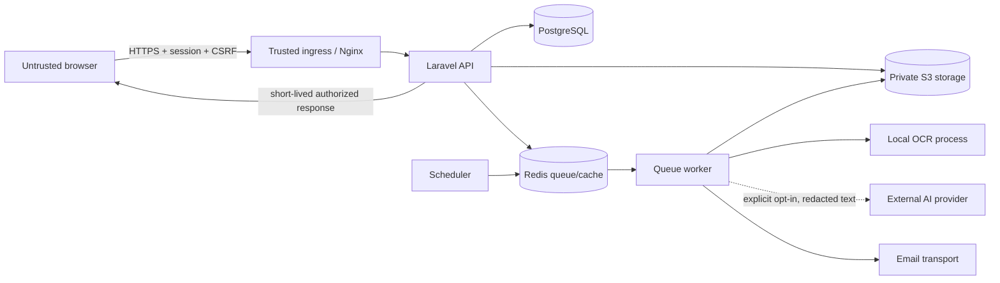

# KeepProof Threat Model

Status: living design document for the pre-release application

Last reviewed: 2026-07-20

This model covers the KeepProof modular monolith, Vue SPA, workers, scheduler, PostgreSQL, Redis, private S3-compatible storage, local OCR, email delivery, and the optional external extraction-provider boundary. It does not claim that a particular public deployment has been penetration-tested.

## Security and privacy objectives

1. A user can access only data belonging to a household of which they are a current member.
2. Receipt files, extraction text, exports, and claim packages remain private and are disclosed only for an authorized, short-lived operation.
3. Untrusted documents cannot change application instructions, execute code, choose storage paths, or activate deadlines without human confirmation.
4. Retried jobs and requests do not duplicate sensitive effects.
5. Account export and deletion require recent proof of identity, are auditable, and include or remove all user-owned data as documented.
6. Logs and diagnostics remain useful without containing receipt contents, credentials, tokens, signed URLs, or raw provider payloads.
7. The default local path performs extraction without sending receipt content to an external AI provider.

## Assets

| Asset                                                  | Sensitivity        | Required property                                                       |
| ------------------------------------------------------ | ------------------ | ----------------------------------------------------------------------- |
| Password hashes, reset tokens, sessions, CSRF tokens   | Critical           | Confidentiality, integrity, revocability                                |
| Household membership and role assignments              | Critical           | Integrity and complete server-side authorization                        |
| Purchases, items, notes, deadlines, extraction fields  | Sensitive          | Tenant isolation, integrity, exportability, deletion                    |
| Original receipts and derived documents                | Sensitive          | Private storage, bounded disclosure, content validation                 |
| Raw OCR text and optional provider requests/results    | Sensitive          | Data minimization, separation from confirmed data, no sensitive logging |
| Reminder and job deduplication records                 | Internal           | Integrity and idempotent processing                                     |
| Signing/encryption keys and infrastructure credentials | Critical           | Secret management, rotation, least privilege                            |
| Audit records and correlation identifiers              | Sensitive metadata | Integrity, minimization, restricted access                              |

## Actors and assumptions

- An unauthenticated internet client can register, authenticate, reset a password, and submit malformed or automated requests.
- An authenticated household member may intentionally enumerate ULIDs, modify client requests, upload hostile files, replay operations, or attempt to access another household.
- A malicious receipt can contain malformed image/PDF structures, oversized content, misleading OCR data, or instructions aimed at an extraction model.
- A compromised external provider, mail relay, object store, dependency, or CI action can expose data available to that component.
- Operators can make mistakes with migrations, backups, IAM, proxy headers, secrets, or retention settings.
- PostgreSQL is the system of record. Redis is disposable coordination/cache infrastructure and cannot be the only durable copy of a business event.
- TLS, certificate lifecycle, network policy, backups, and production secret injection belong to the deployment platform and must be verified there.

## Trust boundaries

Every arrow crossing from the browser, a document, email, storage, OCR, or an optional provider is untrusted input. Queue payloads are internal but still contain attacker-influenced identifiers and must be re-authorized or re-scoped when consumed.

## Threats and controls

| Threat                                                   | Primary controls in the design                                                                                                                                                                                | Evidence and verification                                                                                 | Residual risk / deployment work                                                                                         |
| -------------------------------------------------------- | ------------------------------------------------------------------------------------------------------------------------------------------------------------------------------------------------------------- | --------------------------------------------------------------------------------------------------------- | ----------------------------------------------------------------------------------------------------------------------- |
| Cross-household IDOR/BOLA                                | Household-scoped route binding, Laravel policies, scoped relationships, non-sequential public IDs                                                                                                             | `AppServiceProvider`, household policies, tenant-isolation feature tests                                  | Every new model and download route needs an isolation test; database row-level security is not used                     |
| Function-level privilege escalation                      | Owner/member policy decisions at the API, not hidden UI state                                                                                                                                                 | Household policy and authorization tests                                                                  | Policy registration and route coverage require review as modules grow                                                   |
| Session theft or request forgery                         | Stateful Sanctum sessions, CSRF cookie/header flow, session regeneration, logout invalidation, CORS allowlist, HttpOnly/SameSite cookies                                                                      | Authentication feature tests and `config/cors.php` / `config/session.php`                                 | Production must enable HTTPS-only `__Host-`/`__Secure-` cookies, trusted proxy settings, TLS, and HSTS                  |
| Credential stuffing and account enumeration              | Per-identity/IP login and reset limits; generic password-reset response; framework password hashing                                                                                                           | Rate limiter definitions and authentication tests                                                         | Distributed attacks need ingress/WAF telemetry; breached-password screening remains open in the ASVS checklist          |
| Malicious or oversized upload                            | Request and proxy size limits, content-derived MIME checks, allowlisted formats, image re-encoding/metadata removal, PDF validation, quarantine/failure states                                                | Upload validation and state-transition tests                                                              | Antivirus/content disarm is not part of the local MVP and is required for higher-risk public deployment                 |
| Path traversal or public object exposure                 | Server-generated opaque storage keys, private bucket, authorized short-lived URLs, attachment response headers                                                                                                | Storage adapter and authorization tests                                                                   | S3 bucket policy, IAM, URL expiry, access logging, and lifecycle rules must be tested against the chosen provider       |
| OCR command injection                                    | Process arguments remain code-owned; document paths/content are data; time and resource limits; no shell interpretation                                                                                       | OCR adapter contract and hostile-fixture tests                                                            | Native parser vulnerabilities remain possible; isolate OCR workers in a real deployment                                 |
| Prompt injection or untrusted model output               | Receipt text is data only; no tool execution; strict schema; provider limits; opt-in external processing; human confirmation before activation                                                                | Prompt-injection fixture, extractor contract tests, confirmation workflow tests                           | A provider may retain data according to its terms; operator must select and document a compliant provider               |
| Queue replay, concurrent extraction, duplicate reminders | Explicit state transitions, job uniqueness/locking, idempotency records, deterministic in-app notification UUIDs, bounded attempts, durable deduplication keys, and a terminal `delivery_unknown` email state | State-machine, persisted-notification reconciliation, interrupted-worker, retry, and SMTP-ambiguity tests | SMTP can accept a message before a disconnect; such outcomes require operator review and are never automatically resent |
| Export or deletion abuse                                 | Recent password confirmation, authorization, transaction boundaries, audit events, asynchronous cleanup with retry                                                                                            | Export/deletion feature tests and audit assertions                                                        | Object-store deletion can be eventually consistent; versioned buckets need a documented purge policy                    |
| Stored XSS through notes or OCR text                     | Vue text rendering and JSON serialization; no trusted HTML input; CSP at production proxy                                                                                                                     | Frontend rendering tests, CSP configuration, CodeQL                                                       | CSP must be validated at the TLS ingress; future rich-text features require a dedicated sanitizer                       |
| SQL/command injection                                    | Eloquent/query-builder parameterization; allowlisted sort/filter fields; code-owned process arguments                                                                                                         | Static analysis, focused validation tests, code review                                                    | Raw expressions and new process calls require explicit review                                                           |
| Sensitive log or artifact leakage                        | Correlation IDs without receipt bodies; Problem Details without stack traces; synthetic fixtures; CI secret scan                                                                                              | Logging tests, `.gitignore`, CI Gitleaks scan                                                             | Infrastructure access logs and third-party observability require separate redaction and retention validation            |
| Dependency or CI supply-chain compromise                 | Locked Composer/npm dependencies, audits, Dependabot, dependency review, CodeQL, immutable action SHAs, container build validation and SBOMs                                                                  | `.github/workflows`, lock files, generated build artifacts                                                | Base image digests and package registries are not fully hermetic; verify artifacts and signatures for real releases     |
| Data loss or incomplete restore                          | PostgreSQL/object-store backup set, migration discipline, checksums, restore drills                                                                                                                           | Operations runbooks                                                                                       | No RPO/RTO is promised; production needs automated encrypted off-site backups and measured restore drills               |

## Privacy data flow

Local OCR is the default. An external AI adapter must remain disabled unless the operator enables it and the user explicitly consents for the document. The adapter boundary may receive only the minimized/redacted content needed for extraction, with a recorded provider and prompt/schema version. Chain-of-thought is neither requested nor stored.

Raw OCR output is distinct from normalized extraction fields. Extracted values and calculated deadlines stay provisional until a user reviews and confirms them. Deleting the original document does not silently delete confirmed purchase data; account deletion covers both structured records and stored objects.

KeepProof intentionally has no advertising trackers or hidden analytics. A deployment that adds telemetry must update this model, disclose it, and prevent receipt content and identifiers from entering analytics systems.

## Availability and failure behavior

- PostgreSQL unavailable: readiness fails and state-changing requests fail closed; no business state is accepted only in Redis.
- Redis unavailable: cached reads may degrade and queued work/reminders pause. Receipt uploads remain durable as pending PostgreSQL work, expose a delayed state, and are redispatched by the reconciliation command after Redis recovers.
- Object storage unavailable: uploads and downloads fail with a retriable user-facing error; metadata must not claim a file is usable.
- OCR unavailable: the document reaches a bounded failed state and can be retried; manual entry remains available.
- Mail unavailable: in-app state remains authoritative. Any email exception after delivery starts is conservatively recorded as `delivery_unknown` and is not automatically resent; interrupted in-app delivery is safely retried through its deterministic notification identifier.
- External AI unavailable or invalid: no fallback silently sends data elsewhere; local/manual processing continues.

## Explicit non-goals for the MVP

- Legal advice or jurisdiction-specific guarantees about return or warranty law.
- Malware detection equivalent to a dedicated content-disarm or antivirus platform.
- Protection from a fully compromised host, database administrator, or deployment root account.
- Multi-region disaster recovery, formal compliance certification, or a contractual availability target.
- OAuth/OIDC, JWT authentication, WebSockets, public share links, and inbound webhooks.

Adding any non-goal changes the threat surface and requires an updated model, tests, and usually an ADR.

## Review triggers

Review this model when adding a file type, storage provider, public sharing, OAuth/OIDC, webhook, analytics, external AI provider, new privileged role, cross-household feature, background-processing service, or production deployment topology. Also review after a security incident or a material ASVS update.
